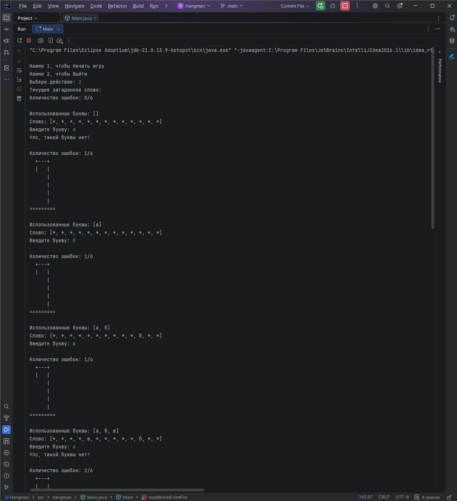
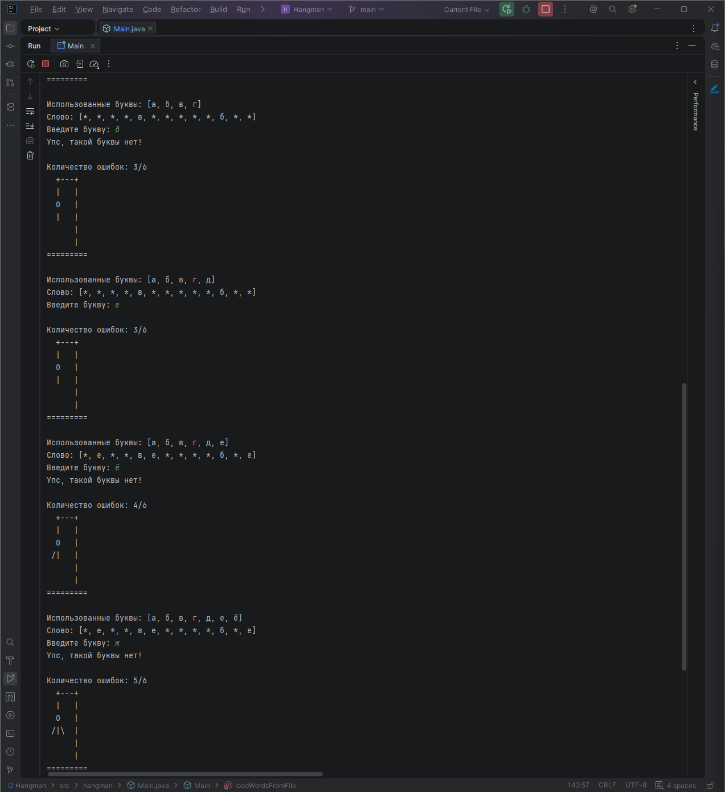
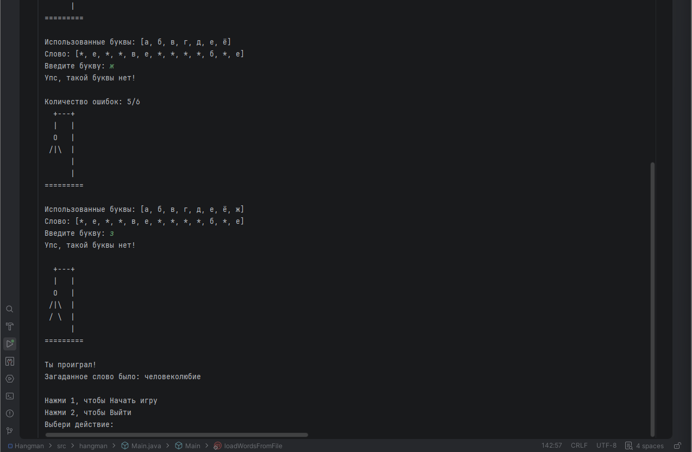

# Виселица (Hangman)
«Виселица» — консольная игра на Java, в которой компьютер случайным образом загадывает слово из словаря, а игрок пытается угадать его по буквам.
Второй игрок по буквам за каждый ход угадывает слово, дается 6 попыток ошибиться - за каждую ошибку добавляется штрафной балл.

Согласно традициям русских игр со словами, загаданное слово должно быть именем существительным, нарицательным в именительном падеже единственного числа.

## Правила игры
Если буква есть в слове, попытка считается успешной. Если же буква повторяется, ход пропускается без начисления штрафного балла.
С каждой ошибкой строится виселица по частям, если она достраивается (игрок совершает 6 ошибок), игра заканчивается проигрышем.
Чтобы выиграть, нужно отгадать слово, пока виселица не достроилась и туловище человечка не нарисовалось полностью на мониторе.

## Как запустить игру
Для запуска игры необходимо установить Java 21 и среду разработки IntelliJ IDEA.
Проект нужно скачать с GitHub и открыть в IntelliJ IDEA. В корневой папке проекта находится файл words.txt, в котором хранятся слова для игры.
После открытия проекта нужно запустить класс Main. В консоли появится главное меню, где можно выбрать начало игры или выход из программы.
Для начала игры необходимо ввести 1, после чего компьютер случайным образом выберет слово из словаря и предложит игроку угадать его по буквам.

## Пример игры

**Начало игры**

**Игровой процесс**

**Завершение игры**

